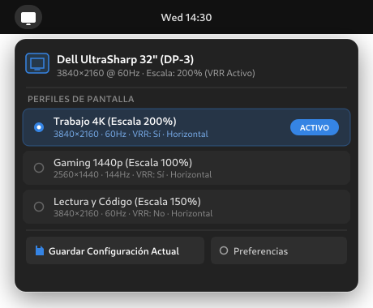
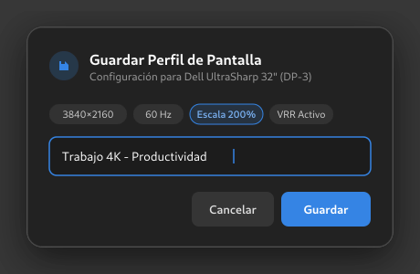
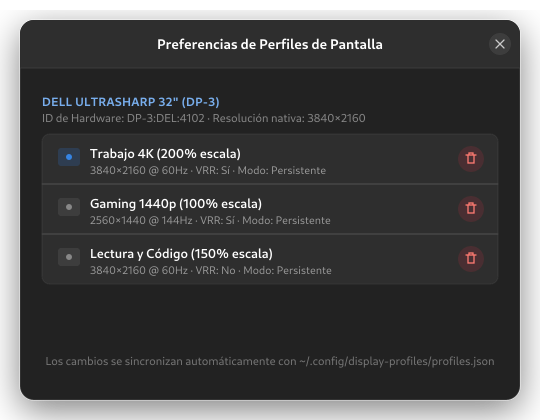
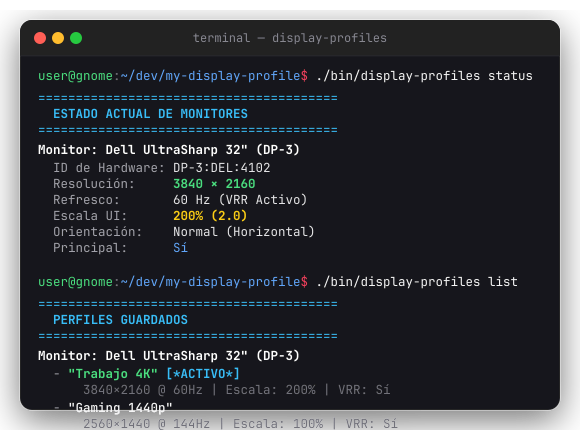

# Display Profile Manager (GNOME Shell Extension & CLI)

[](https://extensions.gnome.org/)
[](https://github.com/ArturoHerrera/display-profile-gnome-ext)
[](https://fedoraproject.org/)
[](https://wayland.freedesktop.org/)
[](LICENSE)

A lightweight, production-grade **GNOME Shell extension** and companion **CLI utility** to manage, save, and switch display profiles (resolution, fractional/integer UI scaling, refresh rate, VRR/Adaptive-Sync, and orientation) per individual monitor instantly.

Built strictly according to official **[extensions.gnome.org (EGO)](https://extensions.gnome.org)** guidelines: modern ESM architecture, asynchronous non-blocking I/O, native Libadwaita preferences, full gettext internationalization (English & Spanish), sub-5ms initialization, and rigorous signal cleanup preventing memory leaks across Shell lifecycles.

---

## Visual Showcase

### Top Panel Indicator & Quick Switcher
Switch between saved display profiles instantly with a single click, or save the active display parameters without interrupting your workflow:

<p align="center">
  
  &nbsp;&nbsp;
  
</p>

### Native Libadwaita Preferences & Companion CLI
Manage, inspect, and safely delete profile configurations from the GNOME Preferences window or script profile switches via the terminal:

<p align="center">
  
</p>

<p align="center">
  
</p>

---

## Highlights & Features

- 🖥️ **Per-Monitor Profiles:** Save independent configuration profiles for each physical or virtual display connected to your system.
- ⚙️ **Granular Display Parameters:**
  - **Resolution:** Full resolution selection (e.g., `3840×2160`, `2560×1440`, `1920×1080`).
  - **UI Scaling:** Integer and fractional scaling (`100%`, `125%`, `150%`, `175%`, `200%`, etc.).
  - **Refresh Rate & VRR:** Multi-frequency support and Variable Refresh Rate (FreeSync / G-Sync / Adaptive-Sync).
  - **Orientation:** Standard horizontal, 90°, 180°, and 270° portrait rotations.
  - **Primary Display:** Retains or updates primary monitor designation seamlessly.
- ⚡ **Instant & Non-Blocking Switching:** Profile changes apply in milliseconds via Mutter D-Bus (`org.gnome.Mutter.DisplayConfig`) without confirmation prompts, automatically updating `~/.config/monitors.xml`.
- 🚀 **Asynchronous & Responsive:** All D-Bus proxy construction, queries, and disk I/O are completely asynchronous (Promise-based `Gio.DBusProxy` and `Gio.File.replace_contents_bytes_async`), ensuring extension startup completes in <5ms with zero compositor stutters.
- 🎨 **Native Libadwaita Preferences (`prefs.js`):** Cleanly view and manage monitor profiles using modern Adwaita cards with instant disk synchronization. Inline deletion is kept off the top panel menu to prevent accidental profile loss.
- 🌍 **Internationalization (i18n):** Full gettext localization with English base and complete Spanish translation (`po/es.po`).
- 🛡️ **Zero Memory Leaks:** Explicit disconnection of all D-Bus signals, Clutter/St actor callbacks, and modal dialogs during extension disable and teardown.
- ⌨️ **Dual Interfaces:**
  - **Top Panel Quick Menu:** Visual status indicators, active profile ornaments, and quick switching.
  - **Standalone GJS CLI (`bin/display-profiles`):** Terminal workflows, automated scripts, and custom keyboard shortcuts.
- 🧪 **Isolated Nested Testing Sandbox:** Built-in runner (`bin/test-sandbox`) to test extension changes in an isolated, nested Wayland session with Mutter Devkit without endangering the host desktop.

---

## Installation

### Option A: extensions.gnome.org (Recommended)

Install directly with one click from the GNOME Extensions website:
👉 **[Display Profile Manager on extensions.gnome.org](https://extensions.gnome.org/extension/display-profiles@arturoherrera/)** *(pending review)*

### Option B: Install from Release Package

Download or build `display-profiles@arturoherrera.shell-extension.zip` and run:

```bash
gnome-extensions install --force dist/display-profiles@arturoherrera.shell-extension.zip
gnome-extensions enable display-profiles@arturoherrera
```

### Option C: Manual Installation from Source

Clone this repository and copy the `src` contents into your user extensions directory:

```bash
mkdir -p ~/.local/share/gnome-shell/extensions/display-profiles@arturoherrera
cp -r src/* ~/.local/share/gnome-shell/extensions/display-profiles@arturoherrera/
gnome-extensions enable display-profiles@arturoherrera
```

*(Note: On Wayland sessions, you may need to log out and log back in for GNOME Shell to discover newly installed extensions).*

---

## Graphical User Interface

### Top Panel Quick Switcher
Clicking the display monitor icon in the GNOME top bar reveals:
1. **Monitor Header:** Shows active connector name (e.g., `Dell UltraSharp 32" (DP-3)`), current resolution, refresh rate, and scaling.
2. **Profile List:** Saved profiles for that monitor. The currently active profile is highlighted with a blue badge and indicator ornament. Clicking any other profile applies it instantly.
3. **Save Current Configuration:** Opens a modal dialog to name and save the current display mode.
4. **Preferences:** Launches the native Libadwaita settings dialog.

### Libadwaita Preferences Window
Open via the quick menu's **Preferences** button or run:

```bash
gnome-extensions prefs display-profiles@arturoherrera
```

The preferences window provides two dedicated Libadwaita tabs:
- **Profiles (`video-display-symbolic`):** Displays grouped cards for each connected monitor and allows one-click profile deletion with immediate persistence to `~/.config/display-profiles/profiles.json`.
- **About (`help-about-symbolic`):** Displays extension name, release version (`v1.0.2` / `EGO v3`), author credits (**Arturo Herrera**), GPL-3.0 licensing, and an interactive link directly to the [GitHub project repository](https://github.com/ArturoHerrera/display-profile-gnome-ext).

---

## CLI Usage (`bin/display-profiles`)

The companion command-line utility provides terminal inspection and automation without opening graphical menus:

| Command | Description | Example |
| :--- | :--- | :--- |
| `status` | Display current hardware, resolution, rate, scale, and VRR status | `./bin/display-profiles status` |
| `list` | List all saved profiles per monitor and show active profile | `./bin/display-profiles list` |
| `save <name> [connector]` | Save current monitor configuration as a named profile | `./bin/display-profiles save "Work 4K"` |
| `add <name> <res> <scale>` | Manually create a profile specifying resolution and UI scale | `./bin/display-profiles add "Gaming" 2560x1440 100%` |
| `apply <name> [connector]` | Apply a saved profile instantly | `./bin/display-profiles apply "Work 4K"` |
| `delete <name> [connector]`| Delete an existing profile | `./bin/display-profiles delete "Work 4K"` |
| `--version`, `-v` | Display program version and GNU GPLv3+ license information | `./bin/display-profiles --version` |
| `--help`, `-h` | Display usage instructions and examples | `./bin/display-profiles --help` |

### CLI Output Examples

```bash
# Check current monitor parameters
$ ./bin/display-profiles status
========================================
  ESTADO ACTUAL DE MONITORES
========================================
Monitor: Dell UltraSharp 32" (DP-3)
  ID de Hardware: DP-3:DEL:4102
  Resolución:     3840 × 2160
  Refresco:       60 Hz (VRR Activo)
  Escala UI:      200% (2.0)
  Orientación:    Normal (Horizontal)
  Principal:      Sí

# List all saved profiles
$ ./bin/display-profiles list
========================================
  PERFILES GUARDADOS
========================================
Monitor: Dell UltraSharp 32" (DP-3)
  - "Trabajo 4K" [*ACTIVO*]
      3840×2160 @ 60Hz | Escala: 200% | VRR: Sí
  - "Gaming 1440p"
      2560×1440 @ 144Hz | Escala: 100% | VRR: Sí
```

### Custom Shortcuts & Automation

You can easily bind custom keyboard shortcuts in GNOME (`Settings` → `Keyboard` → `View and Customize Shortcuts` → `Custom Shortcuts`):

- **Shortcut 1:** `Ctrl + Super + 1` → `/path/to/my-display-profile/bin/display-profiles apply "Trabajo 4K"`
- **Shortcut 2:** `Ctrl + Super + 2` → `/path/to/my-display-profile/bin/display-profiles apply "Gaming 1440p"`

---

## Development & Testing

### Isolated Sandbox Testing (`bin/test-sandbox`)

When developing GNOME Shell extensions, running untested code directly inside your host desktop can freeze your session if bugs occur. This project provides an isolated sandbox runner:

```bash
# Launch an isolated nested GNOME Shell Wayland instance in a dedicated window
./bin/test-sandbox

# Run automated headless sanity verification of extension loading and D-Bus IPC
./bin/test-sandbox --check
```

The runner configures dedicated temporary sandboxes for `XDG_RUNTIME_DIR`, `XDG_CONFIG_HOME`, and `XDG_DATA_HOME`, launching the extension via `dbus-run-session` and Mutter Devkit. The host session remains completely safe.

### Automated Test Suite

Run the end-to-end integration test suite inside the isolated sandbox:

```bash
gjs -m test/test_sandbox_e2e.js
```

### Building & Packaging for EGO (`bin/pack-ego`)

To compile translations and generate the official `.shell-extension.zip` bundle ready for upload to [extensions.gnome.org](https://extensions.gnome.org):

```bash
./bin/pack-ego
```

This compiles gettext catalogs (`po/` → `src/locale/`) and packages the extension into:
`dist/display-profiles@arturoherrera.shell-extension.zip`

---

## Project Structure

```
.
├── assets/
│   └── screenshots/            # Visual previews, UI diagrams, and terminal captures
│       ├── menu-dropdown.png
│       ├── menu-dropdown.svg
│       ├── save-dialog.png
│       ├── save-dialog.svg
│       ├── preferences-window.png
│       ├── preferences-window.svg
│       ├── cli-overview.png
│       └── cli-overview.svg
├── bin/
│   ├── display-profiles        # Standalone GJS CLI utility
│   ├── lint-shexli             # Isolated Shexli static analysis linter
│   ├── pack-ego                # Official extensions.gnome.org packager
│   └── test-sandbox            # Isolated nested Wayland sandbox test runner
├── src/
│   ├── metadata.json           # Extension metadata & UUID (display-profiles@arturoherrera)
│   ├── extension.js            # Top panel menu indicator & modal dialogs
│   ├── prefs.js                # Native Libadwaita Preferences Window
│   ├── displayManager.js       # Asynchronous Mutter D-Bus client (Promise-based)
│   ├── storage.js              # Asynchronous JSON profile persistence manager
│   └── locale/                 # Compiled binary gettext catalogs (.mo)
├── po/
│   ├── display-profiles.pot    # Translation template
│   └── es.po                   # Spanish translation catalog
├── dist/
│   └── display-profiles@arturoherrera.shell-extension.zip # Distribution bundle
├── test/
│   └── test_sandbox_e2e.js     # End-to-end integration test suite
├── openspec/                   # Formal OpenSpec change specifications & archive
├── LICENSE                     # GNU General Public License v3.0 (GPL-3.0-or-later)
└── README.md
```

---

## License

This project is licensed under the terms of the GNU General Public License v3.0 or later (GPL-3.0-or-later). See [LICENSE](LICENSE) for details.
